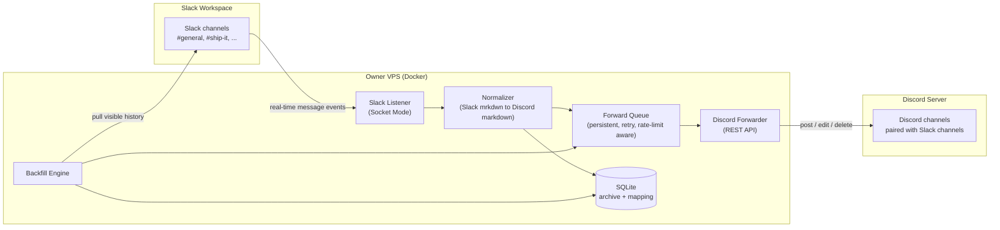
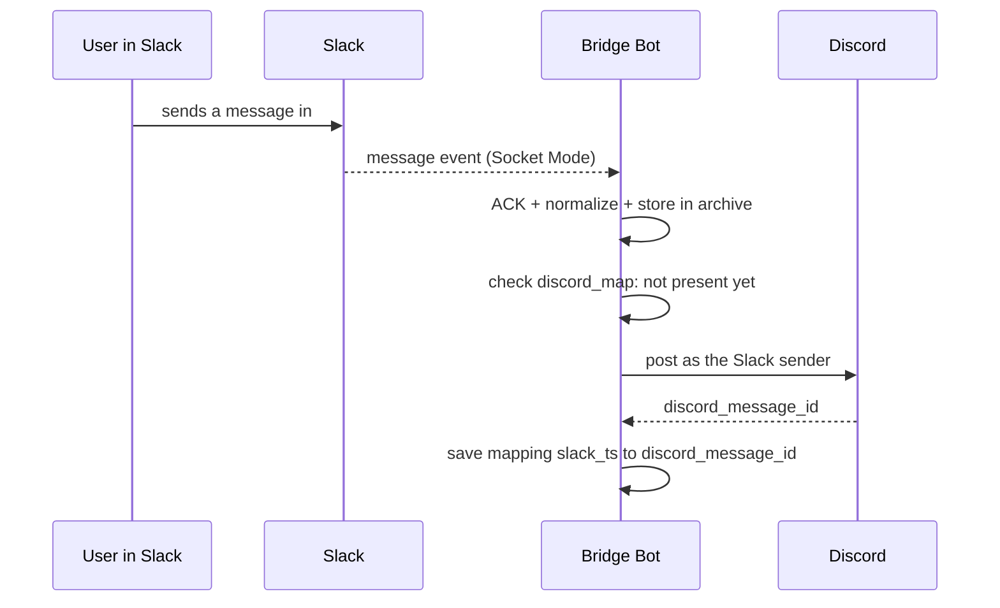
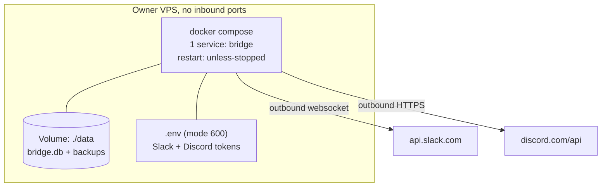

# ARCHITECTURE — Slack to Discord Bridge

This document explains how the bridge moves Slack chat to Discord
automatically and in real time, so the owner can:

1. understand the system without reading all of the code,
2. deploy it on his own VPS,
3. maintain, back up, and repair it without depending on anyone.

> Status: v1 design, one-way direction (Slack → Discord).
> Behavioral reference: Slackord (see README credits). This project is
> an original Python implementation; no Slackord code is used.

---

## 1. Goals and Non-Goals

### v1 goals

- Every new message in a watched Slack channel **appears automatically
  in its paired Discord channel** a few seconds after it is sent.
- Runs 24 hours a day with no human involvement: no manual exports,
  no GUI application (unlike Slackord, which imports Slack export
  JSON files).
- History that is still visible in Slack (about 90 days on the free
  plan) is migrated the first time the bot runs (**backfill**),
  without duplicating real-time messages.
- Edits and deletions in Slack are mirrored to Discord.
- Slack thread replies become Discord threads / replies.
- Files and images are relayed (downloaded from Slack, re-uploaded
  to Discord).
- The bot can be redeployed on any VPS with only Docker and a `.env`
  file. There is no dependency on any other service or runtime.

### Non-goals for v1

- **Two-way sync.** Replies posted in Discord are not sent back to
  Slack. Slack remains the single source of truth. (A possible v2,
  with a separate loop-prevention design.)
- Private Slack DMs are not migrated (privacy, and Slackord does not
  support them either).
- Reactions are not synced in v1.
- Slack accounts are not mapped to Discord accounts; messages appear
  in Discord under the Slack sender's identity (name and avatar are
  imitated by the bot or webhook), not from the person's own Discord
  account.

---

## 2. Design Principles

| Principle | What it means in this project |
|---|---|
| **Standalone** | One repo, one container. No AI services, no database server, no domain name. |
| **Outbound only** | Every connection is opened *from* the VPS outward (Slack Socket Mode + Discord API). No inbound port is opened, so it is safe on a NAT VPS. |
| **Idempotent** | Processing the same event twice never creates a duplicate Discord message. The key is the `discord_map` table (`slack_ts → discord_message_id`). |
| **Slack is the source of truth** | When in doubt, Discord follows Slack. The local database is a cache plus a mapping table, not the primary source. |
| **Fail safely** | If Discord is down or rate-limited, messages wait in a persistent queue and are retried, not lost. If the bot dies, on restart it catches up from the last known point. |
| **No secrets in code** | All tokens live only in `.env` (mode `600`, excluded from git). Code never writes a token to the logs. |

---

## 3. System Overview



Three main paths:

1. **Real-time** — a new message is forwarded immediately
   (listener → normalizer → queue → Discord).
2. **Backfill** — at startup, and when the bot joins a new channel,
   visible history is pulled in oldest-to-newest order.
3. **Change sync** — edit/delete events are translated into
   edit/delete calls on the matching Discord message, found through
   the mapping table.

---

## 4. Components

### 4.1 Slack Listener (`bot/slack_listener.py`)

- Opens a **Socket Mode** connection to Slack (outbound websocket,
  app token `xapp-...`). No public URL is needed.
- Subscribes to events: `message` (including the `message_changed`
  and `message_deleted` subtypes), `member_joined_channel`,
  `channel_created`.
- **Auto-join:** right after authentication, if
  `AUTO_JOIN_PUBLIC_CHANNELS` is enabled (the default), the listener
  lists the public channels and calls `conversations.join` for every
  channel the bot is not a member of, using the `channels:join`
  scope. A `channel_created` event triggers the same join for the
  new channel, and the resulting `member_joined_channel` event then
  starts its backfill. Each join and each failure is logged; a
  `missing_scope` error degrades to one clear warning ("grant the
  scope or invite the bot manually") and never crashes startup.
  Private channels are excluded by design: Slack only admits a bot
  to a private channel when a member invites it.
- Every event is ACKed to Slack first, then processed, so the
  listener never blocks.
- Reconnects automatically with backoff when the connection drops
  (handled by `slack_sdk`).
- The bot token (`xoxb-...`) is used for the Web API: user/channel
  lookups, history pulls, and file downloads.

### 4.2 Normalizer (`bot/normalizer.py`)

Converts a Slack message payload into one neutral internal format
(`BridgeMessage`), so the Discord side never needs Slack details:

- `channel_id`, `ts` (unique Slack message ID), `thread_ts`,
  sender (configurable name format: display, real, or user name —
  the same choice Slackord offers), avatar, converted `text`,
  `files[]`, `posted_at`.
- Text conversion: Slack mrkdwn → Discord markdown
  (see `bot/normalizer.py` for the exact rules; code spans are
  protected from conversion). Links are the one deliberate
  exception to markdown: they are emitted as plain text — the bare
  URL, or `label (url)` when Slack stored a real label — never as
  masked markdown links, which some Discord clients render as
  bracketed text.
- System messages (join/leave, topic changes, and similar subtypes)
  are dropped using an explicit list in the code.

### 4.3 Archive Store (`bot/store.py`)

One SQLite database file (`data/bridge.db`, on the Docker volume)
holding the message archive plus the Discord mapping. SQLite was
chosen because it needs no server, and one file is trivial to back
up, which fits a small-to-medium team.

Its two jobs on the hot path are preventing duplicates and letting
edit/delete/thread operations find their Discord counterpart.

### 4.4 Forward Queue (`bot/store.py` + `bot/forwarder.py`)

- A persistent queue (in SQLite, not only in memory) of
  "post / edit / delete to Discord" work items.
- A single worker processes items in insertion order. Queue
  selection additionally enforces strict ordering for posts inside
  each channel: a post is never handed out while an earlier post
  for the same channel is still pending, so a message waiting out
  a rate-limit deferral cannot be overtaken by its channel's later
  messages. Other channels proceed independently, and the ordering
  constraint lifts as soon as the earlier post finishes or fails.
- Discord rate limits are honored: on `429`, the worker defers
  the item for `max(Retry-After, 1s)` plus a small random jitter and
  then continues. A 429 is "slow down", not a failure: deferrals
  never consume the item's failure budget, so even a minutes-long
  rate-limit storm during a big backfill cannot fail an item. Only a
  much higher separate cap on *consecutive* deferrals exists, purely
  as a safety valve against an endless 429 loop.
- Real errors use exponential backoff; after the attempt limit the
  item is marked `failed` and logged (never silently dropped).

### 4.5 Discord Forwarder (`bot/forwarder.py` + `bot/discord_client.py`)

- Talks to the **Discord REST API** with the bot token. No gateway
  connection is needed for one-way posting.
- The bot identity can create channels in the guild, post, edit and
  delete its own messages, create threads from a message, and upload
  files.
- Posting identity: if `config.yaml` provides a **webhook URL** for a
  channel, messages are posted through that webhook with the Slack
  sender's name and avatar (full impersonation, like Slackord).
  Otherwise the bot posts with the sender's name in bold as a prefix.
  Edits and deletes use the same path the original post used.
- Automatic impersonation: with `impersonate: true` in `config.yaml`,
  no hand-pasted webhook URLs are needed. For each paired channel
  the forwarder resolves a webhook in this order: an explicit
  per-channel `webhook` URL from config wins; then a URL remembered
  in the `channels.webhook_url` column; then an existing Discord
  webhook named `Slack Bridge` (adopted); finally a newly created
  one (its URL is stored). Storing the URL in the database keeps it
  across restarts without putting a secret in `config.yaml`, and a
  per-process cache avoids a lookup per message. Self-healing: a
  webhook dies with its channel, so if a webhook call answers
  **404**, the stored URL is forgotten, that one message falls back
  to a normal bot post/edit/delete, and the next message recreates
  the webhook. Webhook setup failures never stop the worker — they
  degrade to bot posts with a warning. Thread replies keep going
  through the webhook with a `thread_id`, exactly like bot-mode
  threads use the thread as the target channel.
- The paired Discord channel is resolved from config; if it does not
  exist and `AUTO_CREATE_CHANNELS=true`, the bot creates it with the
  Slack channel's name and topic (the way Slackord recreates channels
  with their descriptions).

### 4.6 Channel Mapper (`bot/config.py`)

Slack → Discord mapping comes from two sources, in this order:

1. `config.yaml` — manual mapping written by the owner (wins).
2. Same-name auto-discovery — a Slack channel pairs with the Discord
   text channel of the same name in the configured guild.

Example `config.yaml`:

```yaml
channels:
  - slack: general
    discord: general
  - slack: ship-it
    discord: ship-it
  - slack: daily-standup
    discord: daily-standup
# A Slack channel with no config entry and no same-name Discord
# channel is skipped and noted in the log (unless auto-create is on).
```

### 4.7 Backfill Engine (`bot/backfill.py`)

- Runs at startup and when the bot joins a channel.
- Pulls `conversations.history` plus `conversations.replies` (threads)
  page by page, then ingests everything oldest → newest.
- Every message is checked against `discord_map` and the queue first:
  already forwarded means skip. Backfill is therefore safe to repeat
  (this is the bridge equivalent of Slackord's resume function).
- The pagination cursor is stored in `sync_state` while a backfill
  runs, and completion is recorded per channel.
- Honest limit: on the Slack free plan the API only returns roughly
  the last 90 days. Anything older cannot be pulled by this bot; the
  only route for older history is a manual Slackord import done
  before it disappears from Slack's view.

### 4.8 File Relay (`bot/forwarder.py`)

- Slack file URLs are private (they require the bot token). The relay
  downloads the file with the bot token, then re-uploads it as a
  Discord attachment.
- Files larger than `DISCORD_MAX_FILE_MB` (default 25) are forwarded
  as a text note with the file name instead of an upload.
- Files are relayed as-is; no content inspection is performed.

### 4.9 Config and Health

- All configuration comes from the environment (`.env`) plus
  `config.yaml`. Nothing is hidden in code.
- Structured logs go to stdout (read with `docker compose logs`),
  including periodic status: Slack connection state, queue depth,
  and the last successful forward time.
- `python -m bot.main --selftest` validates the store, normalizer,
  and queue behavior with synthetic data and a fake Discord client,
  without any tokens and without posting anything.

---

## 5. Data Model (SQLite)

```sql
channels        (id, name, topic, is_private,
                 discord_id, discord_name, webhook_url,
                 updated_at)

users           (id, name, display_name, real_name,
                 avatar_url, updated_at)

messages        (channel_id, ts, thread_ts, user_id, text,
                 posted_at, edited, deleted, raw,
                 PRIMARY KEY (channel_id, ts))

discord_map     (channel_id, slack_ts, discord_message_id,
                 discord_thread_id,
                 PRIMARY KEY (channel_id, slack_ts))

forward_queue   (id, kind,              -- post | edit | delete
                 channel_id, slack_ts, payload_json,
                 status,              -- pending | done | failed
                 attempts, deferrals, next_retry_at,
                 last_error, created_at)

sync_state      (key, value)           -- backfill cursor per channel,
                                       -- completion flags, etc.
```

The FTS5 index (`messages_fts`) from the archive bot lineage is kept,
so the local archive stays full-text searchable even if Discord is
not used one day.

Discord-side vs Slack-side state are deliberately separable:
`discord_map`, `forward_queue`, the channels' Discord links, and the
backfill bookkeeping keys are the bridge's *memory of Discord*;
`channels`, `users`, and `messages` are the *Slack archive*. The
`--reset-discord` operator command (see README) clears only the
Discord-side half after writing a timestamped database backup, so a
fresh start re-imports the full visible Slack history without
touching the archive. `Store.reset_discord_state()` performs the
clear and returns the per-table counts it removed.

---

## 6. Data Flows

### 6.1 New message (real-time)



### 6.2 Thread reply

For a message with `thread_ts`, the parent is looked up in
`discord_map`. If the parent already has a Discord thread, the reply
goes into that thread. Otherwise the bot creates a thread from the
parent message and stores its `discord_thread_id`. If the parent has
not been forwarded yet, the item waits in the queue until it has.

### 6.3 Edit / delete

A `message_changed` / `message_deleted` event → look up
`discord_message_id` → call edit/delete in Discord → mark the archive
row `edited`/`deleted`. If no mapping exists (the message predates
the bot), the event is logged and skipped, not treated as an error.
If an edit arrives while the original post is still queued, no
separate edit item is created: the queued post always reads the
latest stored text when its turn comes.

### 6.4 Bot stops, then starts again

1. The listener connects; pending queue items are processed first.
2. A backfill pass runs for every member channel; dedupe makes it
   cheap and duplicate-free.
3. Result: messages sent while the bot was down still reach Discord —
   late, but never lost and never duplicated.

---

## 7. Deployment



Repository layout:

```
slack-discord-bridge/
├── ARCHITECTURE.md
├── README.md
├── SETUP.md               click-by-click setup walkthrough
├── LICENSE
├── Dockerfile
├── docker-compose.yml
├── .env.example
├── config.example.yaml
├── requirements.txt
├── bot/
│   ├── __init__.py
│   ├── main.py            entry point and wiring
│   ├── config.py          env + config.yaml loading
│   ├── slack_listener.py  Socket Mode events
│   ├── normalizer.py      Slack payload to BridgeMessage
│   ├── store.py           SQLite archive, mapping, queue
│   ├── discord_client.py  Discord REST API client
│   ├── forwarder.py       queue worker, file relay, threads
│   ├── backfill.py        history pull, oldest to newest
│   └── selftest.py        token-free end-to-end self test
├── tests/                 unit tests (no network)
└── systemd/
    └── slack-discord-bridge.service   non-Docker alternative
```

Deploy summary (details in README):

```bash
git clone <repo> && cd slack-discord-bridge
cp .env.example .env              # fill in the tokens + guild ID
cp config.example.yaml config.yaml
docker compose up -d
docker compose logs -f            # expect: Slack connected, Discord ready
```

VPS requirements: Docker, about 256 MB RAM, about 1 GB disk (excluding
relayed file storage, which lives in Discord, not on the VPS). No
domain, no public IP, and no inbound HTTPS are needed.

---

## 8. Security

- Slack and Discord tokens live only in `.env`, file mode `600`,
  listed in `.gitignore`. Tokens are never logged and never sent
  anywhere except the official Slack/Discord APIs.
- Slack scopes are kept minimal: read history in channels the bot is
  a member of (`channels:history`, `groups:history`), list and
  inspect channels (`channels:read`, `groups:read`), `users:read`,
  `files:read`, and `channels:join` (join public channels without a
  manual invite; no write access to message content). The bot can
  only see channels it belongs to — public ones it joins itself plus
  private ones a member invited it to; that membership list is its
  access boundary.
- The Discord bot gets only the permissions it needs in the target
  server: `View Channel`, `Send Messages`, `Attach Files`,
  `Create Public Threads`, and `Send Messages in Threads` for
  posting, the file relay, and thread replies (`Send Messages` also
  covers editing and deleting the bot's own posts). On top of that:
  `Manage Messages` for the webhook-mode fallback (editing or
  deleting a post whose webhook is gone), `Manage Webhooks` only
  when impersonation (`impersonate: true`) manages webhooks, and
  `Manage Channels` only when `AUTO_CREATE_CHANNELS=true`. The
  client is REST-only, so no gateway intents are involved.
- The local archive (`bridge.db`) contains chat content; treat
  database backups with the same care as the tokens.

---

## 9. Failure Modes and Recovery

| Event | Bot behavior |
|---|---|
| Slack connection drops | Automatic reconnect with backoff, then a backfill pass catches up on missed messages |
| Discord rate limit (429) | The item is deferred for `max(Retry-After, 1s)` plus jitter and retried; deferrals never consume the failure budget, so a rate-limit storm alone cannot fail an item (a very high cap on consecutive deferrals guards only against an endless loop) |
| Discord outage | Items stay `pending` in the queue and are retried periodically |
| VPS reboot / container crash | `restart: unless-stopped`; on start, pending queue items are processed and backfill catches up |
| Slack/Discord token revoked | Clear error in the log and processing stops (no silent crash loop); the owner replaces the token in `.env` and restarts |
| Database corruption | The archive can be rebuilt from a Slack backfill (about 90 days); losing `discord_map` risks duplicates for old messages, so weekly backups of `data/` are recommended |
| Message edited before it is forwarded | The worker always reads the latest stored text at posting time |

---

## 10. Honest Limitations

- **The Slack free plan still limits the past**: the bot can only
  pull what Slack still shows (about 90 days). This bridge prevents
  *future* loss; it cannot resurrect what is already hidden.
- **Ordering is guaranteed inside one channel**, not across channels.
- **Normal latency** is a few seconds. During a large backfill or a
  rate-limit window it can grow to minutes, and that is visible in
  the logs/status.
- **One Slack workspace and one Discord guild per container.** A
  second pair means a second container with its own `.env` and data
  directory.
- **Private channels always need a manual invite.** Auto-join covers
  public channels only; Slack's platform rules give a bot no way to
  enter a private channel on its own.
- Sender names and avatars in Discord are imitations created by the
  bot/webhook, not the person's real Discord account (the same
  limitation Slackord has).

---

## 11. Design Decisions (ADR summary)

| # | Decision | Reason | Rejected alternative |
|---|---|---|---|
| 1 | Socket Mode, not Slack webhooks | No public URL needed; fits a NAT VPS | Events API + HTTPS endpoint (needs a domain and reverse proxy) |
| 2 | Discord bot token over REST, webhooks optional per channel | Bot can edit/delete/create threads and channels; webhooks give full name/avatar impersonation for posting | Webhook-only (posting only, incomplete sync) |
| 3 | SQLite, not Postgres/MySQL | One file, no extra server, backup is a file copy | A database server (too heavy for this team size) |
| 4 | Persistent queue in SQLite | A restart never loses work | In-memory queue (lost on crash) |
| 5 | Docker Compose as the primary path | One-command deploy, identical environment everywhere | Manual per-VPS installs (version drift) |
| 6 | One-way v1 | Slack as the single source of truth, no loops | Two-way (deferred to a possible v2 with its own anti-loop design) |
| 7 | Auto-join public channels via the `channels:join` scope (on by default, `AUTO_JOIN_PUBLIC_CHANNELS`) | Removes the per-channel manual `/invite` step; the scope grants no message-writing power, and failure degrades to a warning | Manual `/invite` for every channel (still the only route for private channels) |

---

## 12. Roadmap After v1

1. **v1.1** — reaction sync and a status command.
2. **v1.2** — export the local archive to files (JSON/HTML).
3. **v2 (if decided)** — two-way mode with origin markers to prevent
   loops, plus edit conflict rules.

---

## Appendix A — Tokens and Apps the Owner Needs

**Slack App** (created once at api.slack.com, installed to the
workspace): Socket Mode ON → app token `xapp-...`; bot token
`xoxb-...`; seven bot scopes: `channels:history`, `groups:history`,
`channels:read`, `groups:read`, `users:read`, `files:read`,
`channels:join`; event subscriptions: `message.channels`,
`message.groups`, `member_joined_channel`, `channel_created`. With
`channels:join` granted, the bot joins public channels by itself
(auto-join is on by default), so no manual invites are needed for
them; private channels still require a member to run
`/invite @BridgeBot` inside the channel.

**Discord Bot** (created once at discord.com/developers): bot token;
no privileged gateway intents (the client is REST-only and never
opens a gateway connection); invite it to the target server with
the permissions listed in section 8. SETUP.md walks through both
apps click by click.

All tokens are entered by the owner directly into `.env` on his own
VPS. No token ever travels through chat or any third party.
